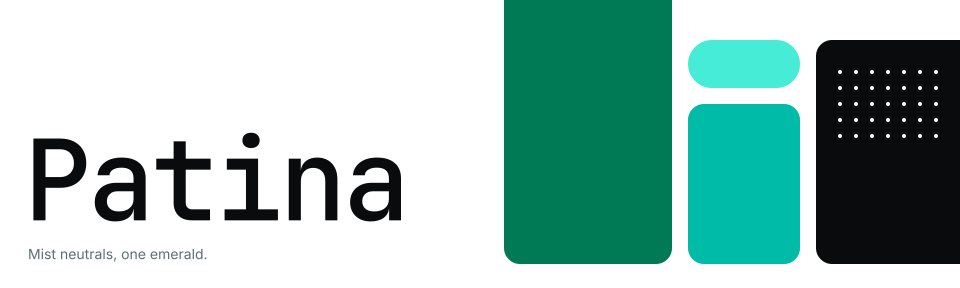

<p align="center">
  
</p>

# Patina

[English](README.md) · [한국어](README.ko.md)

A design system built on one emerald accent over a calm blue-gray neutral (Mist). It targets three platforms from a single set of design tokens:

- **Web**: a [shadcn](https://ui.shadcn.com) registry on the **Luma** lineage, with Base UI, Tailwind 4 and a tighter radius scale.
- **Desktop**: a [Slint](https://slint.dev) token file, with `compact-*` density tokens.
- **Android**: static Material 3 theme files for Jetpack Compose (no dynamic colour).

> **Status: draft.** The design and tokens are finished, and `pnpm build` already generates the registry base item, the Slint token file and the Android theme files. The font files and all 25 components are built and checked by an automated install test. The deployment is not done yet, so the install commands below describe the planned interface.

## What is in this repo

| Path | Contents |
|---|---|
| `design-system/tokens.json` | The single source of truth: colour (light and dark), type, spacing, radius, size and shadow tokens |
| `design-system/README.md` | The visual language: colour, type, density, radius, states, motion, icons, accessibility, UI copy rules |
| `design-system/Android.md` | How the tokens map to Material 3 roles, typography and shapes |
| `design-system/components/` | A visual preview of every component (`preview.html`) and the shared `bundle.css` / `bundle.js` |
| `design-system/assets/Licenses/` | Licence texts for the fonts and icons |
| `fonts/` | The official D2Coding and MaruBuri files that are served at `/fonts/*`, with `SHA256SUMS` |
| `design-system/VERSION` | Identifier of the committed token snapshot |
| `registry/ui/` | The shadcn components (Base UI + Tailwind 4): Button, Badge, Input, Card, Label, Separator, Skeleton, Table, Checkbox, Toggle, ToggleGroup, Collapsible, Pagination, Popover, DropdownMenu, Sheet, NavigationMenu, Chart, Kbd, Switch, Alert, Tooltip, Tabs, Select, Article. Each becomes a registry item |
| `slint/` | The Slint library: `patina.slint` (entry) and `components/` (Button, Input, Badge, Kbd, Tooltip, Separator, TreeRow, ListRow, PaneHeader). The build adds `tokens.slint` and an archive |
| `android/` | The Android library: `PatinaTheme.kt` and `components/` (PatinaButton, PatinaCard, PatinaTextField, PatinaSwitch, PatinaRadioButton, PatinaFilterChip, PatinaAlertDialog, PatinaTopAppBar, PatinaListItem, PatinaBadge). The build adds the generated theme files and an archive |
| `docs/` | The sources of the agent documentation, `agent-guide.md` and `agents-snippet.md`, the README header image `header.svg` and the GitHub social preview `social-preview.png` |
| `tools/` | Reference scripts: oklch to sRGB with WCAG contrast (`cc.py`), Android role mapping (`m3.py`), tokens to CSS (`tokens_css.py`) |

## Principles

- **Semantic colour names only.** Components never use colour literals or compute state colours; every hover, tint and ring is a named token, so web, Slint and Android render the same values.
- **One primary action per screen.** Emerald marks the primary action and active states, never decoration. Destructive actions are tinted, not solid.
- **Accessible by construction.** Every text colour meets 4.5:1 on the background it is meant for, in both themes, and focus rings meet 3:1. The build is meant to fail when a token breaks these numbers.
- **Two densities, never mixed.** Comfortable for the web, compact for dense desktop tools.
- **Type:** Inter for text, JetBrains Mono for headings and code, Pretendard for Korean, Newsreader with MaruBuri for long-form reading, D2Coding for column-aligned Korean code. Icons are [Phosphor](https://phosphoricons.com).

Read [`design-system/README.md`](design-system/README.md) for the full guide.

## Planned usage

Everything is served as static files from `https://patina.ptcookie.net`.

**Web (shadcn).** In a project that already has Astro (or any React setup), Tailwind 4 and an `@/*` alias, initialise from the base item. It sets the tokens, installs the font packages, and switches the icon library to Phosphor:

```bash
npx shadcn@latest init https://patina.ptcookie.net/r/base.json
```

Then register the namespace in `components.json` and add components by name:

```json
{
  "registries": {
    "@patina": "https://patina.ptcookie.net/r/{name}.json"
  }
}
```

```bash
npx shadcn@latest add @patina/button @patina/badge @patina/input @patina/card @patina/table @patina/chart
```

Install Patina's components before stock ones. Each Patina item has the name of the shadcn component it replaces and writes the same file; a stock component that depends on it (`alert-dialog` needs `button`) will ask whether to overwrite the file, and the answer is no. Components Patina does not override resolve from the stock shadcn registry.

**Slint and Android.** Download the generated file once and commit it to your project; do not fetch it at build time.

| Platform | File |
|---|---|
| Slint | `/slint/patina-slint.tar.gz` (the tokens and the compact components; unpack it, register `patina.slint` as the library `patina`, import from `@patina`) |
| Android | `/android/patina-android.tar.gz` (the Compose theme, tokens, icons and components; unpack it into your sources) |

Every generated file carries a header with the token snapshot it came from.

## For AI agents

An agent that builds UI with Patina should read `https://patina.ptcookie.net/llms.txt` (an index in the [llms.txt](https://llmstxt.org) format) or `https://patina.ptcookie.net/llms-full.txt` (the whole documentation in one file). To make a project use it, paste `https://patina.ptcookie.net/agents-snippet.md` into that project's `AGENTS.md` or `CLAUDE.md`. The guide covers the rules (colour only by token name, one primary action per view), setup for web, Slint and Android, and every component and token. It is written in `docs/agent-guide.md`; the build adds the component and token tables, so they cannot drift from the code.

## Fonts

| Font | How to get it |
|---|---|
| Inter, JetBrains Mono, Newsreader | Fontsource variable packages (`@fontsource-variable/*`), self-hosted by your build |
| Pretendard | The official [`pretendard`](https://www.npmjs.com/package/pretendard) npm package (dynamic subset on the web); official files for Slint and Android |
| D2Coding, MaruBuri | Official files, served at `/fonts/*`: download that folder into your project's `public/fonts` |

For D2Coding and MaruBuri, copy `D2Coding-*.ttf`, `MaruBuri-*.otf`, their `*-OFL.txt` licence texts and `patina-fonts.css` into `public/fonts`, then load the stylesheet next to the files:

```html
<link rel="stylesheet" href="/fonts/patina-fonts.css" />
```

Pretendard, D2Coding and MaruBuri have Reserved Font Names under the SIL OFL: use the official files unmodified, and do not subset or convert them. The repository pins its copies with `fonts/SHA256SUMS`, and the build fails if a file differs. Ship the matching licence text from `design-system/assets/Licenses/` with every font or icon set you distribute.

## Development

`pnpm build` verifies the tokens (derived colours, contrast, Material 3 pairs) and fails if any check does not hold, then writes the generated files to `public/`. Use Node 24 or 22.12+ and pnpm 11.

```bash
pnpm build   # verify the tokens, then generate the registry, tokens.slint and Android files into public/
pnpm check   # typecheck, lint, format check and tests (contrast, derived tokens, generated files)
pnpm smoke   # install the generated registry item into a scratch Astro project with the real shadcn CLI (needs the network)
pnpm deploy  # build, then deploy to Cloudflare Workers
```

Reference scripts run today with plain Python 3:

```bash
python3 tools/cc.py "oklch(0.5 0.1 160)" "oklch(1 0 0)"   # contrast ratio of two colours
```

## Licences

Patina's code and documentation are released under the [MIT licence](LICENSE). The fonts are not: they keep their SIL Open Font License 1.1 licences, and Phosphor Icons and shadcn/ui, which parts of this repository come from or are derived from, are MIT-licensed by their authors. The notices and the full texts are in [`THIRD_PARTY_NOTICES.md`](THIRD_PARTY_NOTICES.md) and [`design-system/assets/Licenses/`](design-system/assets/Licenses/). Keep them when you copy files into a project.
